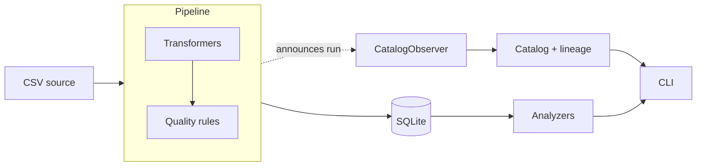

# A real estate analytics pipeline that catalogs its own data


## What it does

PropertyIQ ingests raw real estate listings, cleans them through a chain of composable transformers, and validates the result against configurable quality rules. Every dataset the pipeline touches is automatically profiled, quality-scored, and linked into a lineage graph by an observer that listens to each run, so nothing is registered by hand. The resulting catalog can be searched and traced from the command line, and the cleaned data feeds analyzers such as median price by city.

## Quick start

Requires Python 3.10 or newer.

```bash
# 1. Create and activate a virtual environment
python -m venv .venv
source .venv/bin/activate          # Windows: .venv\Scripts\activate

# 2. Install the project with its dev tools
pip install -e ".[dev]"

# 3. Generate a deliberately messy sample dataset (312 listings)
python scripts/generate_sample_data.py

# 4. Run the pipeline: clean, validate, store, and catalog
propertyiq run
```

Expected output:

```
312 rows in, 300 rows out
Quality score: 66.7%
  FAIL (1 rows): not_null['address', 'price']
```

The 12 duplicate listings are removed, and the quality score reflects one listing with a missing price.

### Explore the results

```bash
propertyiq report                           # median price by city
propertyiq catalog list                     # every dataset in the catalog
propertyiq catalog search price             # find datasets by name, tag, or column
propertyiq catalog lineage listings_clean   # what feeds this dataset
```

Lineage output:

```
Upstream:   raw_listings
Downstream: -
```

### Run the tests

```bash
pytest
ruff check .
```

## Architecture



## Design patterns

Each pattern is here because it solves a specific problem in the pipeline, not for show.

| Pattern | Where | Why it's used |
|---|---|---|
| **Template Method** | `BaseSource.run()` in `ingestion/base.py` | `run()` fixes the order of steps (fetch, convert to a DataFrame, validate the schema). Subclasses like `CSVSource` supply only the parts that differ, so every source behaves consistently. |
| **Strategy** | `Transformer`, `Rule`, and `Analyzer` base classes | Each family shares one method (`transform`, `check`, `analyze`), so the pipeline, validator, and CLI can run any of them without knowing what they do. Adding a new one means adding a subclass, and nothing else changes. |
| **Observer** | `Pipeline` and `CatalogObserver` | The pipeline announces each finished run to its observers and never mentions the catalog. The catalog listens and records the dataset, quality score, and lineage on its own. A logger or alert could be added the same way. |
| **Repository** | `Repository` and `SQLiteRepository` in `storage/` | The rest of the project saves and loads DataFrames through an abstract interface, so swapping SQLite for Postgres or Parquet touches one file. |
| **Composition** | `Pipeline` | A pipeline *has* transformers, a validator, and observers, rather than inheriting from them. Behavior is assembled from small parts. |
| **Immutable value objects** | `Property`, `PipelineRun`, `RuleResult`, `QualityReport`, and the catalog entries | Frozen dataclasses mean a record of something that happened can't be changed by accident as it moves between components. |

### Extending the project

Because of these patterns, new functionality never requires editing existing code:

- **A new data source** is a `BaseSource` subclass that implements `fetch()`.
- **A new cleaning step** is a `Transformer` subclass.
- **A new quality check** is a `Rule` subclass.
- **A new report** is an `Analyzer` subclass.
- **A new storage backend** is a `Repository` subclass.

## Project layout

```
propertyiq/
├── src/propertyiq/
│   ├── models.py             # Property: frozen dataclass for one listing
│   ├── runner.py             # run_listings(): wires source, pipeline, storage, catalog
│   ├── ingestion/
│   │   ├── base.py           # BaseSource (Template Method) and SchemaError
│   │   └── csv_source.py     # CSVSource with column renaming
│   ├── processing/
│   │   ├── base.py           # Transformer base class
│   │   ├── transformers.py   # PriceNormalizer, AddressStandardizer, Deduplicator, DerivedMetrics
│   │   ├── quality.py        # Rule hierarchy, QualityReport, Validator
│   │   └── pipeline.py       # Pipeline, PipelineRun, PipelineObserver
│   ├── storage/
│   │   ├── base.py           # Repository base class
│   │   └── sqlite_repo.py    # SQLiteRepository
│   ├── catalog/
│   │   ├── entries.py        # ColumnEntry and DatasetEntry
│   │   ├── profiler.py       # profile_dataframe()
│   │   ├── catalog.py        # Catalog: register, search, save, load
│   │   ├── lineage.py        # LineageGraph: upstream and downstream tracing
│   │   └── observer.py       # CatalogObserver: records each pipeline run
│   ├── analytics/
│   │   ├── base.py           # Analyzer base class
│   │   └── analyzers.py      # MedianPriceByCity
│   └── cli/
│       └── main.py           # Typer commands: run, report, catalog ...
├── data/
│   └── raw/
│       └── listings.csv      # sample input: 312 deliberately messy listings
├── tests/                    # pytest suite, one file per component
├── scripts/
│   └── generate_sample_data.py   # builds the sample listings CSV
├── .github/workflows/ci.yml  # runs ruff and pytest on Python 3.10 and 3.12
└── pyproject.toml
```

Dependencies point one way: `catalog` imports from `processing`, and `processing` never imports from `catalog`. That's what lets the pipeline announce runs to observers without knowing the catalog exists.

## Roadmap

- [x] Second data source: a `BaseSource` subclass for a real provider's export, using `column_map` to normalize its headers
- [ ] Census ACS enrichment pipeline, giving a dataset two upstream sources in the lineage graph
- [ ] More analyzers: price trends over time, listings by state, affordability index
- [ ] Postgres `Repository` implementation
- [ ] Schema drift detection that flags when a source changes its columns
- [ ] Docker setup so the whole project runs with one command